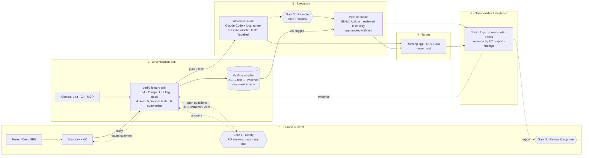

# Architecture · AI-Assisted Feature Verification

AI plans; the team's own frameworks execute; deterministic code judges; people decide only what
needs their authority. Verification runs end to end without approvals; open questions, blocked
operations and unreviewed tests are recorded as exceptions (INTENT-001).

Design canvas (editable): https://claude.ai/artifact/GqWaVmerTPd9cFQtTC75Jr

## Who does what

| Part | Owner | Implemented by |
|---|---|---|
| Story, acceptance criteria, Gate 1 answers | Product owner | `jira/` (simulated) or Jira via the cloud adapter |
| Gap questions (rules) | Deterministic | `verifykit/gaps.py` |
| Gap questions (judgement), plan, tests, triage | Claude | `clarify-story`, `verify-feature` skills |
| Running tests | The team's framework | `verify.config.json` suites → `verifykit/runner.py` |
| Evidence and coverage | Deterministic | `verifykit/evidence.py` (JUnit XML) |
| Verdict | Deterministic rules | `verifykit/report.py`, rules in `references/gates.md` |
| Gate 2 review | Reviewer | `promote-tests` skill + `verify.py promote` |
| Gate 3 decision | Accountable person | `verify.py approve` |

## Why deterministic execution

The same story, plan and commit give the same commands, the same parsing and the same
verdict. Claude's judgement is confined to what is written down and reviewed (questions,
plan, tests), so every result can be traced and re-run without the model.

## Guardrails

Allow-listed commands without a shell, never a production URL, no literal secrets in
config, shared-data writes only where an environment allows them, unpromoted tests withheld
from pipeline runs, uncommitted application or reviewed-test changes recorded, a time limit
per suite. A per-suite violation blocks that suite only; the rest still run. See
`.claude/skills/verify-feature/references/guardrails.md`.
