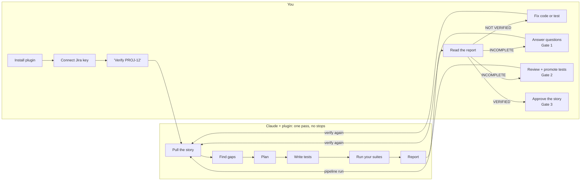

# Developer workflow: verify your story

You installed the `ai-feature-verification` plugin, built a feature, and have its Jira story.
This is how you go from "I built it" to "verified and approved".

**[workflow.html](workflow.html)** is the full diagram with setup commands and a verdict guide.
GitHub shows HTML as source, so download it or open it from a clone in your browser. The
same flow, simplified:



## 1. Once per machine

```bash
claude plugin marketplace add kendallmark3/ai-feature-verification
claude plugin install ai-feature-verification@ai-feature-verification
```

Then set `JIRA_BASE_URL`, `JIRA_EMAIL` and `JIRA_API_TOKEN` in your shell profile. The email
must belong to the account that created the token. Details and a connection check:
[install-plugin.md](../../install-plugin.md#connect-your-jira-once-per-machine).

## 2. One pass

In your repo, say **"Verify PROJ-12"**. The first time, Claude shows you the test commands it
found and waits for you to confirm them. After that, each pass runs to the end without
stopping:

| Step | What happens | Written to `verification/PROJ-12/` |
|---|---|---|
| Pull the story | Reads it from Jira; numbers the criteria AC-1, AC-2… | `story.json` |
| Find gaps | Vague words, missing numbers, undefined rules become questions for the story owner | `gate1-clarifications.md` |
| Plan | Each criterion → the tests that check it → the evidence they must produce | `VERIFICATION_PLAN.md` |
| Write tests | In your own framework, tagged `PROJ-12 AC-n`, marked `@ai-proposed` | your test folders |
| Run your suites | Your own test commands; results from JUnit XML, plus screenshots | `runs/` (not committed) |
| Report | A verdict, a row per criterion, and findings for developers | `VERIFICATION_REPORT.md`, `findings.json` |

Testing never waits for answers. An open question marks only its own criteria UNRESOLVED;
everything else is tested.

## 3. Read the verdict and act

| Verdict | Means | You do |
|---|---|---|
| **NOT VERIFIED** | A test failed | **Confirmed failure** (reviewed test): fix the code. **Suspected defect** (unreviewed test): check the test first. **Requirement ambiguity**: answer the linked question |
| **INCOMPLETE** | Nothing failed, but something couldn't be shown yet | Answer open questions (in chat, on the `Answer:` lines, or by fixing the criteria in Jira); review and promote the tests; commit and do a pipeline run |
| **VERIFIED** | Every criterion has passing evidence from a pipeline run of reviewed tests on committed code | Post the results to the story if you want, and approve it |

## 4. Verify again

After each fix, answer or promotion, say **"Verify PROJ-12 again"**. Answers and promotions
are saved in the repo, so each pass picks up where the last one left off. Once the tests are
promoted and your changes committed, ask for a **pipeline run**: only that kind of run can
reach VERIFIED.

## What to say

| When | Say |
|---|---|
| Start | "Verify PROJ-12" |
| Questions | "Ask me the PROJ-12 questions" |
| After a fix | "Verify PROJ-12 again" |
| Tests reviewed | "Promote the PROJ-12 tests, I'm &lt;name&gt;" |
| Final run | "Run PROJ-12 in pipeline mode" |
| Done | "Post results to PROJ-12" · "Approve PROJ-12, I'm &lt;name&gt;" |

Claude never answers questions, promotes tests or approves a story for you. Those three gates
are always a person's decision.
